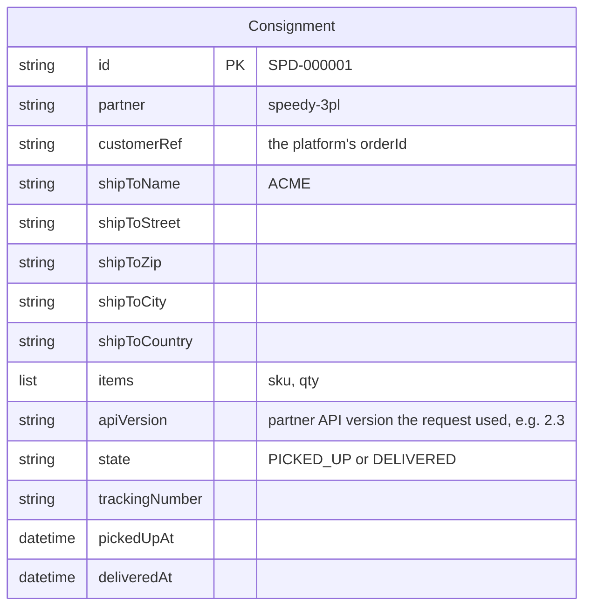

# Simulated 3PL partner: data model

The third-party logistics partner (`speedy-3pl`) keeps consignments in its own language: a
consignment is picked up, then delivered. Cosmos DB account `cosmos-intplat-3pl`, database `3pl`,
partition key `/id`. Only the 3PL System API reads it (ADR 0007).

The partner's shipment API is strict: the 3PL System API accepts exactly the fields of the
partner's current API version and refuses anything else (the v2.4 story, step 8).
