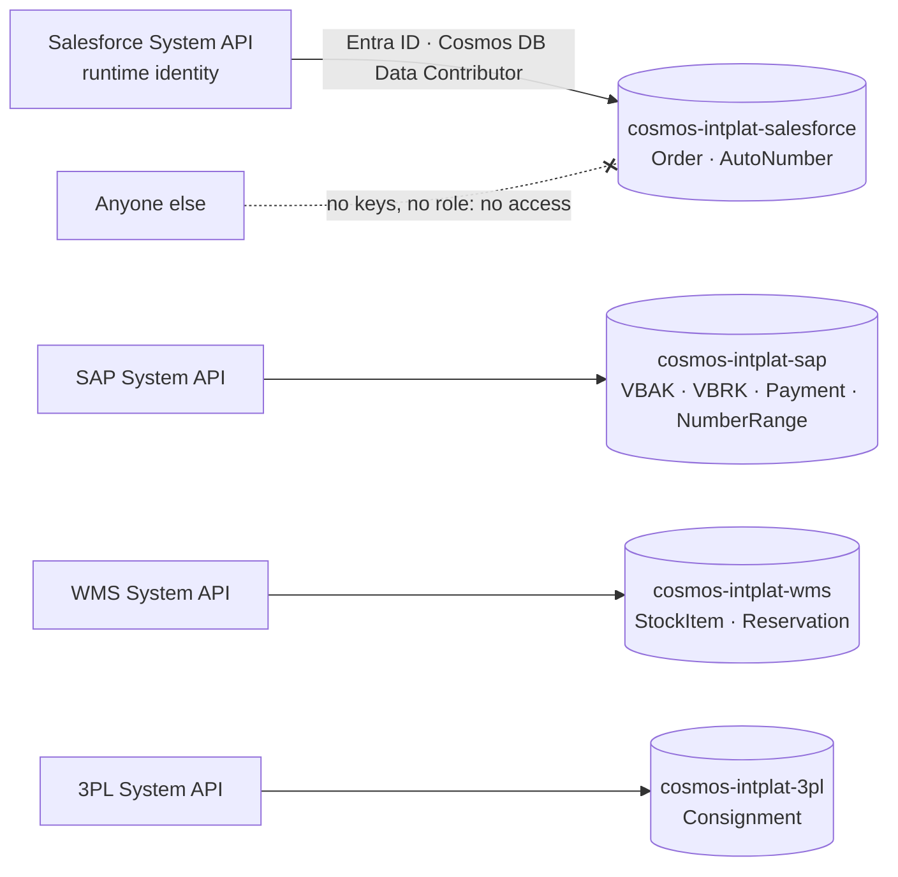

# backend-systems

The **simulated source systems** of the
[AI Intelligence Domain demo](https://github.com/azure-intelligence-domain/ai-intelligence-domain):
Salesforce, SAP, the warehouse and the 3PL partner. Each keeps its own data in its own model and
is reachable **only through its System API** (ADR 0007).

| System | Store | System API | Status |
|---|---|---|---|
| Salesforce (system of record for orders) | Cosmos DB serverless `cosmos-intplat-salesforce` | [system-api-salesforce](https://github.com/azure-intelligence-domain/system-api-salesforce) | ✅ |
| SAP (finance) | `cosmos-intplat-sap` ([model](sap/README.md)) | [system-api-sap](https://github.com/azure-intelligence-domain/system-api-sap) | ✅ |
| Warehouse (WMS, supply) | `cosmos-intplat-wms` ([model](wms/README.md)) | [system-api-wms](https://github.com/azure-intelligence-domain/system-api-wms) | ✅ |
| 3PL partner (logistics) | `cosmos-intplat-3pl` ([model](3pl/README.md)) | [system-api-3pl](https://github.com/azure-intelligence-domain/system-api-3pl) | ✅ |

- Entra ID only: key authentication is disabled; only the System API's runtime identity has a
  data role.
- Each system's own data model: [salesforce](salesforce/README.md), [sap](sap/README.md), [wms](wms/README.md), [3pl](3pl/README.md).
- Resource group `rg-intplat-backend-systems` (deleted by the kill switch, rebuilt by the pipeline).
