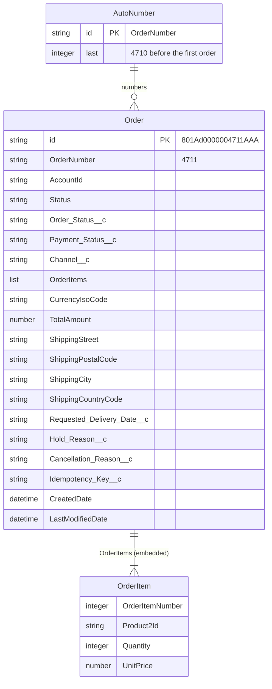

# Simulated Salesforce: data model

Salesforce keeps its own data model, with Salesforce's own naming: standard fields in
PascalCase, custom fields ending in `__c`. The Salesforce System API translates it to the
platform's contract; nobody else reads it (ADR 0007).

## `Order` (container `Order`, partition key `/id`)

| Field | Type | Meaning |
|---|---|---|
| `id` | string | Salesforce record id, e.g. `801Ad0000004711AAA` |
| `OrderNumber` | string | Auto-number, e.g. `4711` (the order id the platform uses) |
| `AccountId` | string | The customer account, e.g. `ACME` |
| `Status` | string | Salesforce's own status: `Draft`, `Activated` or `Cancelled` |
| `Order_Status__c` | string | The order domain's status (placed, confirmed, onHold, cancelled, …) |
| `Payment_Status__c` | string | unpaid, invoiced, paid |
| `Channel__c` | string | salesforce, webshop, agent |
| `OrderItems` | array | `{ OrderItemNumber, Product2Id, Quantity, UnitPrice }` |
| `CurrencyIsoCode` | string | ISO 4217 |
| `TotalAmount` | number | Sum of the items |
| `ShippingStreet`, `ShippingPostalCode`, `ShippingCity`, `ShippingCountryCode` | string | Delivery address (Salesforce flattens addresses) |
| `Requested_Delivery_Date__c` | string | ISO 8601 date |
| `Hold_Reason__c`, `Cancellation_Reason__c` | string | Set when held or cancelled |
| `Idempotency_Key__c` | string | Key of the request that created the order |
| `CreatedDate`, `LastModifiedDate` | string | ISO 8601, UTC |

## `AutoNumber` (container `AutoNumber`)

One document `{ "id": "OrderNumber", "last": 4710 }`, incremented with optimistic concurrency
(ETag). The first order after a fresh build is **4711**.

## Diagram

The domain view (Account, Opportunity, Product, and how the platform's contract maps onto this
record) is in [system-api-salesforce](https://github.com/azure-intelligence-domain/system-api-salesforce#data-model-sales-domain).
