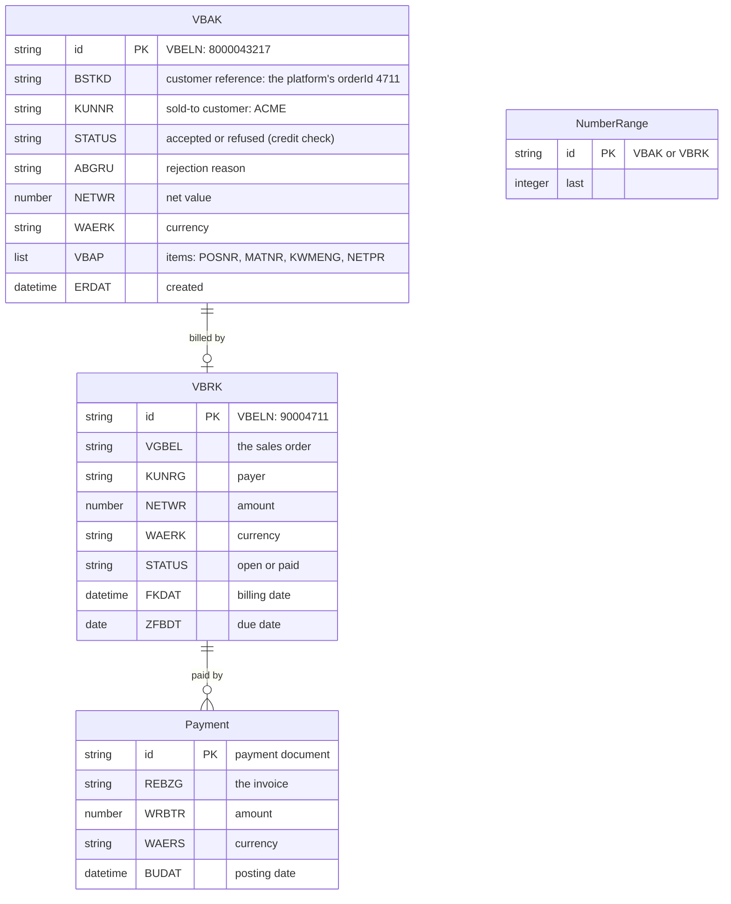

# Simulated SAP: data model

SAP keeps its own data model with SAP's own table and field names. The SAP System API translates
it to the platform's contract; nobody else reads it (ADR 0007). Cosmos DB account
`cosmos-intplat-sap`, database `sap`, partition key `/id` everywhere.

| Container | SAP table | Holds |
|---|---|---|
| `VBAK` | Sales document header (with its items, VBAP) | The sales order created from an order |
| `VBRK` | Billing document header | The invoice of a sales order |
| `Payment` | Incoming payment (simplified) | Money received against an invoice |
| `NumberRange` | Number ranges | Next sales order (8000043217 first) and invoice (90004711 first) number |

The credit check is simulated: an order above 250,000 (in its currency) is refused.
