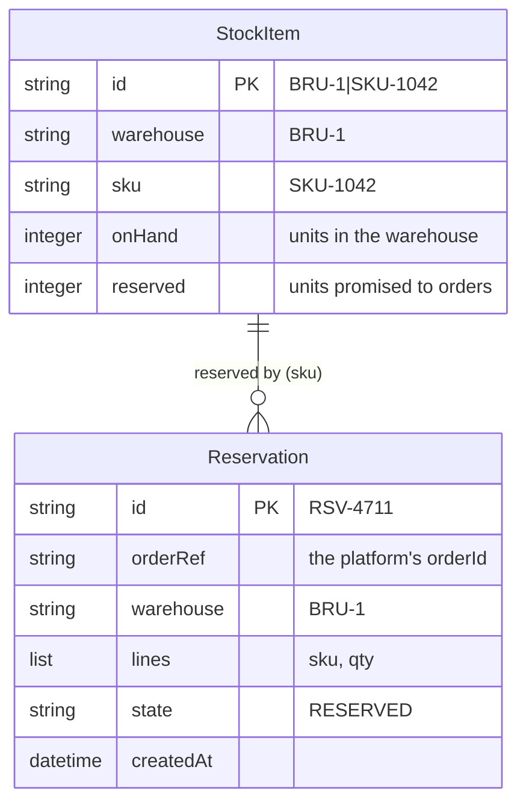

# Simulated WMS: data model

The warehouse management system keeps stock per warehouse and product, and a reservation per
order. Cosmos DB account `cosmos-intplat-wms`, database `wms`, partition key `/id` everywhere. Only
the WMS System API reads it (ADR 0007).

A product the WMS has never seen starts with 1,000 units in warehouse `BRU-1`: the simulation never
runs dry, unless an order asks for more than is left.
